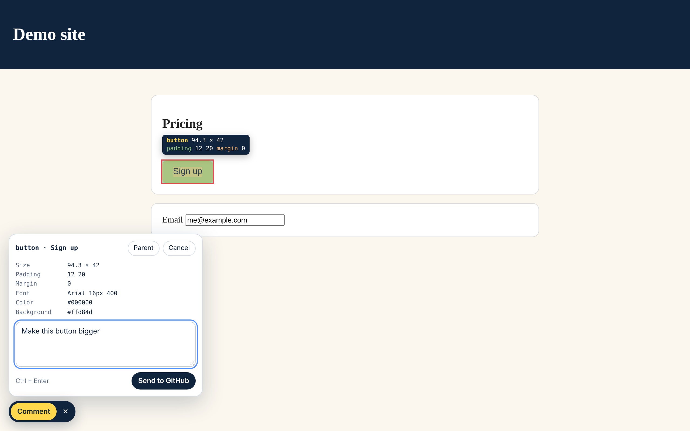

# Review Kit

Click any element on your website, write what should change, and it lands on GitHub. Claude picks it up, fixes it on a branch and opens a pull request.



- **Any site:** one `<script>` tag, no framework needed. Next.js, Astro, Vite, SvelteKit, plain HTML, WordPress themes.
- **Any host:** Vercel, Netlify, Cloudflare Pages, your own Node server, or a free relay for static hosts like GitHub Pages.
- **Safe on a live site:** invisible to visitors. Only people with a private review link can comment, each with their own key you can revoke.
- **The GitHub token never reaches the browser.** It stays on your server or the relay.
- **Everything Claude needs:** page, selector, size, padding and margin, styles, device and a screenshot (private fields covered).
- **Works without staging or pull requests:** comments then go to a "Site review" issue.

## Start here

**[Getting started guide](docs/GETTING-STARTED.md)**: about 15 minutes, no coding.

The short version, in Claude Code on your site's repository:

> Install Review Kit from github.com/tilltonystark/review-kit on this site.

Then, whenever comments come in:

> Check the review inbox.

Or install the skill once as a plugin: `/plugin marketplace add tilltonystark/review-kit`, then `/plugin install review-kit@review-kit`.

## How it works

```
Reviewer's browser ──send──▶ your server or the relay ──GitHub API──▶ PR comment / "Site review" issue
   (widget, no token)          (token, key check, rate limit)                     │
        ▲                                                                          ▼
   preview / live site ◀──deploys── pull request ◀──opens PR── Claude ("check the review inbox")
```

## What's in this repo

| Path | What |
| --- | --- |
| `skills/review-kit/` | The Claude skill: install, work the inbox, maintain, security rules |
| `widget/src/` | The comment widget (TypeScript, Shadow DOM). Built to `dist/widget/` |
| `server/core.ts` | The server handler (standard `Request` → `Response`) |
| `server/{next,vercel,netlify,cloudflare,node}.ts` | Thin adapters per host |
| `relay/` | Cloudflare Worker for sites without a server |
| `github/workflows/` | Optional: keep `staging` equal to `main`; auto-start Claude on new comments |
| `docs/` | Getting started, troubleshooting |

## Development

```bash
npm install
npm test          # handler and relay tests
npm run build     # widget -> dist/widget, server -> dist/server (commit dist/)
npm run e2e       # browser test on desktop and phone (needs Playwright)
```

## Licence

MIT
