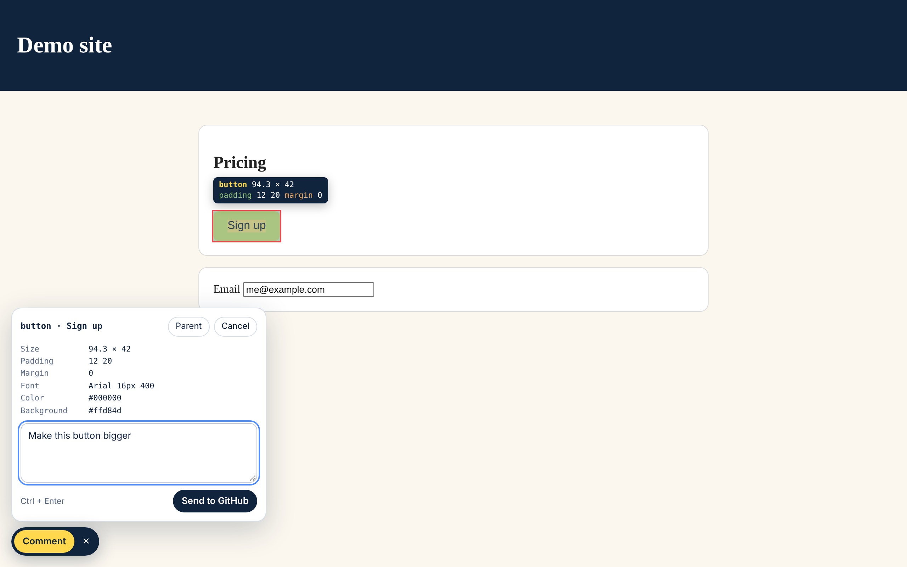
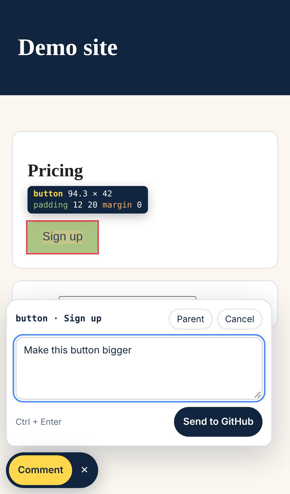

# Getting started with Review Kit

This guide gets you from nothing to your first comment in about 15 minutes. You don't need to write code; Claude does that part. You'll click through two websites (GitHub and your host) and copy two values.

## What you get

- A small **Comment** button on your website, visible only to you and the people you invite.
- Click it (or press `C`), click anything on the page, write what should change, press **Send to GitHub**.
- The comment lands on GitHub with everything needed to find and fix it: the page, the exact element, its size and spacing, your screen size and a screenshot.
- You tell Claude **"check the review inbox"**. Claude fixes each comment on a branch, opens a pull request, and replies with the link. You check it and merge.

## What you need

| You need | Why | Don't have it? |
| --- | --- | --- |
| Your website's code on **GitHub** | Comments are stored there and Claude fixes the code there | Ask Claude to put the site on GitHub first |
| **Claude Code** (desktop app, terminal or claude.ai/code) with your site's repo | Claude installs Review Kit and does the fixes | [claude.ai/code](https://claude.ai/code) |
| Access to where the site is **hosted** (Vercel, Netlify, Cloudflare...) | To add two secret settings | Ask whoever set up the site |

## Step 1. Ask Claude to install it

Open Claude Code on your site's repository and say:

> Install Review Kit from github.com/tilltonystark/review-kit on this site.

Optional, so Claude always knows how: add it as a plugin once with `/plugin marketplace add tilltonystark/review-kit`, then `/plugin install review-kit@review-kit`.

## Step 2. Answer Claude's three questions

1. **Live site or previews only?** If your host makes a preview link for each change (Vercel, Netlify and Cloudflare do), pick both. If you only have the live site, pick live. Visitors never see it either way.
2. **Who will review?** Give names. Each person gets their own private link, so you can see who wrote what and remove one person without affecting the others.
3. **Screenshots?** Yes, unless your GitHub repository is public (then screenshots would be public too).

Claude adds the files on a new branch and opens a pull request. It will then give you **reviewer keys** (one per person, they look like `k_Xq3...`). Keep that message; you'll paste them in step 4.

## Step 3. Make a GitHub token

The token lets your website post comments to your repository, and nothing else.

1. Open **[github.com/settings/personal-access-tokens/new](https://github.com/settings/personal-access-tokens/new)** (you may need to sign in).
2. **Token name:** `Review Kit – your site name`.
3. **Expiration:** 90 days. Review Kit warns you 14 days before it runs out.
4. **Resource owner:** the account or organisation that owns the site's repository.
5. **Repository access:** choose **Only select repositories**, then pick your site's repository.
6. **Permissions → Repository permissions**, set exactly these three to **Read and write**:
   - **Contents** (stores screenshots on a separate `review-assets` branch)
   - **Issues** (comments on the live site go to a "Site review" issue)
   - **Pull requests** (comments on a preview go to its pull request)
7. Press **Generate token** and **copy** it. GitHub shows it only once. It starts with `github_pat_`.

Don't paste the token into a chat with anyone, including Claude. It goes straight into your host in the next step.

## Step 4. Add two secrets to your host

Add these two settings. Claude tells you the exact screen for your host; the short version is below.

| Name | Value |
| --- | --- |
| `REVIEW_KIT_GITHUB_TOKEN` | The token from step 3 |
| `REVIEW_KIT_REVIEWERS` | The line Claude gave you, like `Satyam:k_Xq3..., Om:k_9fP...` |

- **Vercel:** Project → **Settings → Environment Variables**. Add each one, switch on **Sensitive**, tick **Production** and **Preview**. Save.
- **Netlify:** Site → **Site configuration → Environment variables → Add a variable**. Tick **Contains secret values**, scope **Functions**, all deploy contexts.
- **Cloudflare Pages:** Workers & Pages → your project → **Settings → Variables and Secrets** → **Add** → type **Secret**, for Production and Preview.
- **No server (GitHub Pages and similar):** Claude walks you through a free "relay" on Cloudflare instead, about 5 extra minutes. The two values go there.

Then **redeploy** (Vercel: Deployments → ⋯ → Redeploy. Netlify: Deploys → Trigger deploy. Cloudflare: Deployments → Retry). Settings only reach new deployments.

## Step 5. Check it works

Claude checks this for you, but you can too: open your site with your link (next step), press **Comment**. If something is missing, a red message in the panel says what. See [Troubleshooting](#troubleshooting).

## Step 6. Leave your first comment

1. Open your **review link**: `https://your-site.com/?review-key=YOUR_KEY` (Claude gives you each person's link). The key is remembered in that browser and removed from the address bar. Do this once per browser or phone.
2. Press **Comment** (bottom left) or the `C` key.
3. Move over the page: the coloured box shows the element's size, padding (green) and margin (orange), like browser developer tools.
4. Click the thing you want changed. Too small a selection? Press **Parent** to take the surrounding block.
5. Write what should change, as you'd say it to a designer: "Make this button full width on phones".
6. Press **Send to GitHub** (`Ctrl + Enter`, or `⌘ + Enter` on a Mac). A green note links to your comment.

On a phone it works the same: tap **Comment**, tap the element, the text box opens at the bottom.

## Step 7. Let Claude work

Say to Claude: **"check the review inbox"**. Claude:

1. Collects every new comment (from pull requests and the "Site review" issues).
2. Fixes them on a branch and opens one pull request, or pushes to the pull request the comments were left on.
3. Replies on GitHub with what changed, and marks each comment done with a 🚀.
4. Sends you the pull request and its preview link.

Open the preview, comment again if something still looks off, and **merge** the pull request when it's right. Your host puts it live.

Want Claude to start by itself on every new comment? Ask Claude to "turn on Review Kit auto-pickup". It needs an Anthropic API key and uses API credits.

## Where comments go

| You commented on | It goes to |
| --- | --- |
| A preview of a branch with an open pull request | That pull request |
| The live site | The issue "Site review: production" (or "Site review: main") |
| A branch with no pull request, like `staging` | The issue "Site review: <branch>" |

The issues are created the first time and labelled `review-kit`. Close them yourself when you're happy; Claude never closes them.

## Day to day

| I want to... | Do this |
| --- | --- |
| Add a reviewer | Ask Claude: "add Priya as a Review Kit reviewer". You paste the new line into `REVIEW_KIT_REVIEWERS` and redeploy. |
| Remove a reviewer | Ask Claude, or delete their `Name:key` from `REVIEW_KIT_REVIEWERS`, then redeploy. Their link stops working. |
| Renew the token | Make a new one (step 3), replace `REVIEW_KIT_GITHUB_TOKEN`, redeploy, delete the old token on GitHub. |
| Hide the button in my browser | Press ✕ on the button, or open `?review-key=off`. Bring it back with your review link. |
| Turn it off for everyone | Set `REVIEW_KIT_DISABLED` to `1` and redeploy. |
| Review the live site without touching it | Ask Claude to "add a staging branch that mirrors live". |
| Uninstall | Ask Claude to "remove Review Kit". |

## Troubleshooting

| Message | What it means | Fix |
| --- | --- | --- |
| Review Kit has no GitHub token on this site yet | `REVIEW_KIT_GITHUB_TOKEN` is missing on this deployment | Step 4, then redeploy |
| Review Kit needs reviewer keys on this site | `REVIEW_KIT_REVIEWERS` is missing | Step 4, then redeploy |
| Enter your review key / That review key is not valid | This browser has no key, or yours was removed | Open your review link again, or ask for a new one |
| The GitHub token is invalid or has expired | The token ran out or was deleted | Step 3 again, replace the value, redeploy |
| The GitHub token can't write to this repository | Wrong repository picked, or a permission missing | Edit the token on GitHub: select the repo, set the three permissions to Read and write |
| Issues are turned off for this repository | The repo has Issues switched off | GitHub repo → Settings → General → Features → tick Issues |
| Can't reach the Review Kit server / server part is missing | The site has no `/api/review-kit` yet, or it's switched off | Make sure Claude's pull request is merged and deployed; check `REVIEW_KIT_DISABLED` |
| The GitHub token expires in N days | Early warning | Renew the token (Day to day) |
| That's a lot of comments in one hour | Spam protection: 20 per person per hour | Wait, or ask Claude to raise `REVIEW_KIT_RATE_LIMIT` |
| No Comment button at all | Not a reviewer in this browser, or hidden | Open your review link; on a preview, open `?review-key=on` |
| Comment sent but no screenshot | The page was too heavy to capture, or Contents permission is missing | The comment still has everything else; check the token's Contents permission |

## What is stored where

- **The GitHub token**: only in your host's secret settings (or the relay). Never in the browser, never in your code.
- **Reviewer keys**: in your host's secret settings, and in each reviewer's browser after they open their link.
- **Comments**: on GitHub, in your repository's pull requests and issues. Public if your repository is public.
- **Screenshots**: on the `review-assets` branch of your repository. It's never deployed or merged. Form fields and anything marked `data-review-private` are covered before capture. Delete old files any time.
- **Visitors** without a key download one tiny script (about 1 KB) that does nothing.
